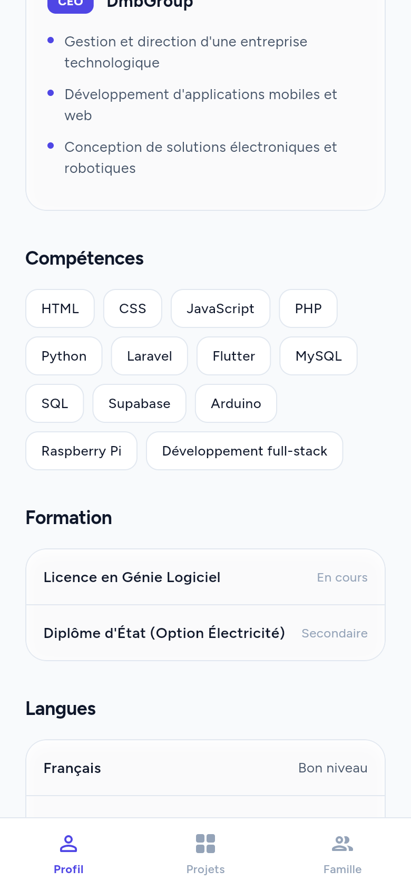
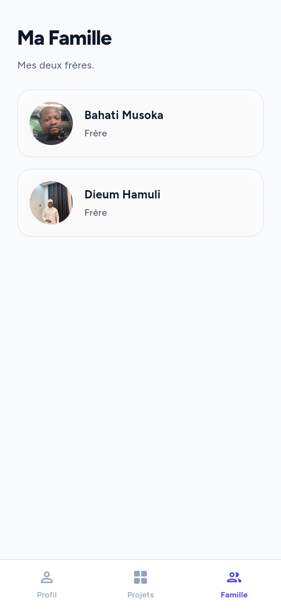

# CV Flutter – Musoka Hamuli Jean

Application mobile Flutter qui présente mon CV, mes projets, ma famille et mes coordonnées.
L'accès à l'application se fait par une page de connexion.

## Fonctionnalités

- **Connexion** : formulaire avec identifiant, mot de passe masqué (affichable via l'icône œil) et bouton « Se connecter ».
- **Profil (CV)** : photo, nom, titre, coordonnées (téléphone, e-mail, ville), profil, expérience, compétences, formation et langues.
- **Projets** : mes réalisations techniques (IoT, web, robotique, FinTech).
- **Famille** : les membres de ma famille avec leur photo, leur nom et leur lien de parenté.
- **Navigation** : une barre de navigation en bas de l'écran (Profil, Projets, Famille) et un bouton de déconnexion.

## Identifiants de test

| Identifiant | Mot de passe |
|-------------|--------------|
| `jean`      | `jean0101`   |

## Captures d'écran

### 1. Page de connexion


### 2. Page d'accueil (Profil, CV et coordonnées)

| | | |
|:---:|:---:|:---:|
|  |  |  |

### 3. Page Projets


### 4. Page Famille



## Technologies

- Flutter / Dart (Material 3)
- [`google_fonts`](https://pub.dev/packages/google_fonts) : polices

## Lancer le projet

```bash
flutter pub get
flutter run
```

## Auteur

**Musoka Hamuli Jean** – Développeur logiciel & systèmes embarqués, Goma (RDC)
