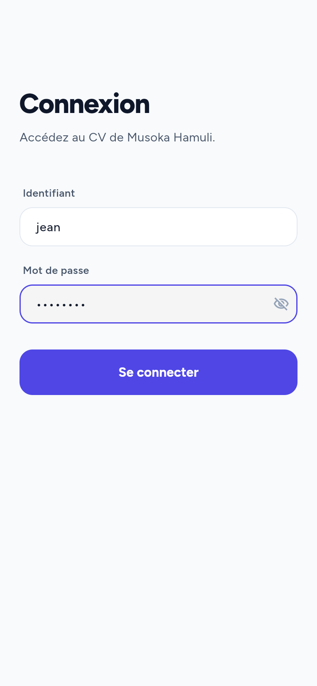
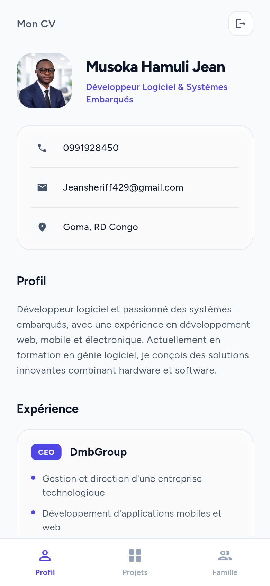
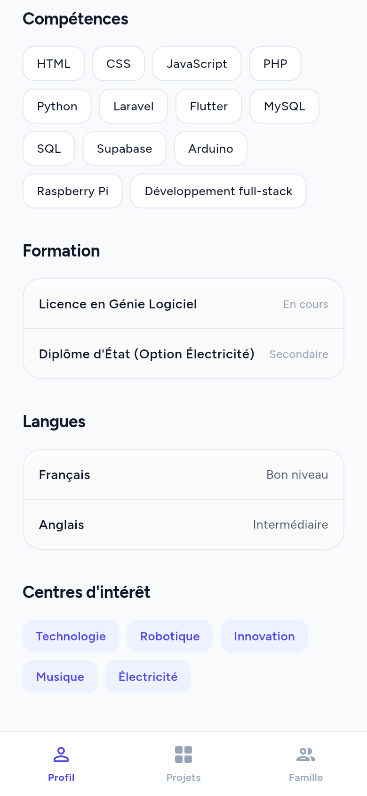
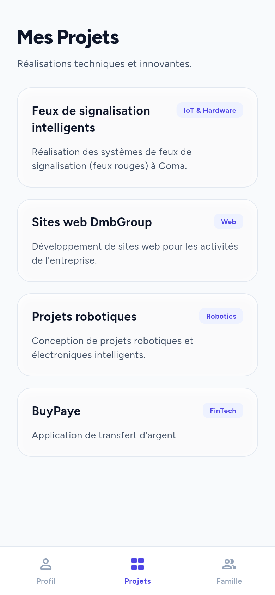
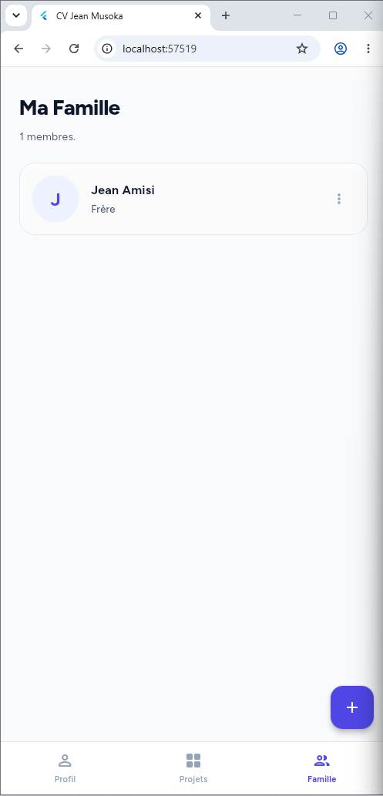
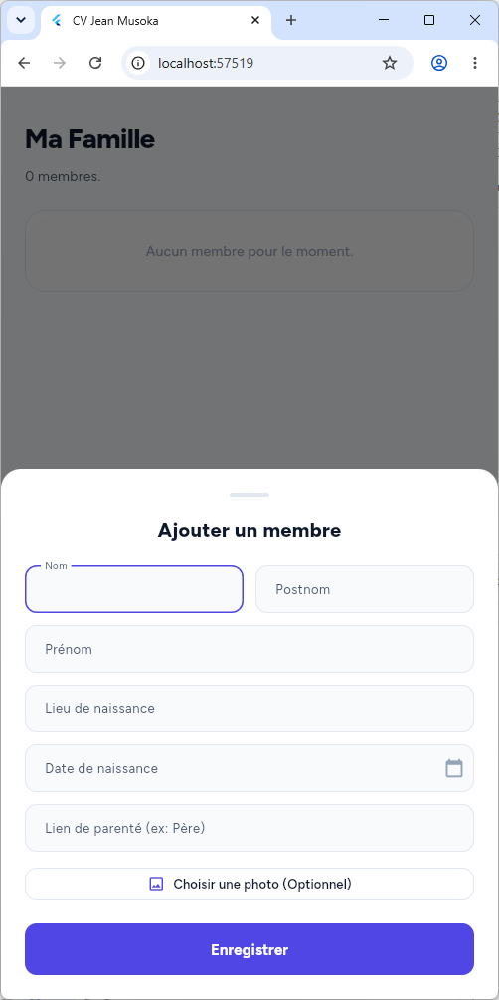
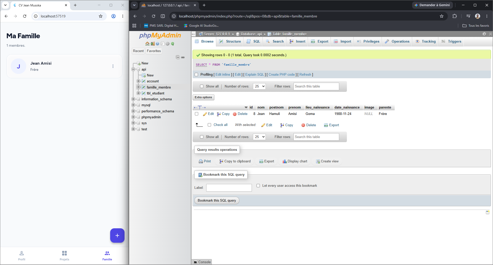

# CV Flutter – Musoka Hamuli Jean (Dynamique)

Application mobile Flutter complète présentant le CV de Musoka Hamuli Jean, avec authentification réelle et gestion dynamique des membres de la famille via une API REST et une base de données MySQL.

## Fonctionnalités

- **Authentification** : Connexion sécurisée via l'API (`/accounts/login`).
- **Accueil (CV)** : Affichage du profil, des coordonnées, de l'expérience, des compétences, de la formation et des langues.
- **Projets** : Réalisations techniques (IoT, web, robotique, FinTech).
- **Famille (CRUD)** : Ajout, consultation, modification et suppression des membres de la famille en temps réel (avec gestion des photos et sélection de la date de naissance).
- **Navigation** : Barre de navigation fluide (Profil, Projets, Famille) et bouton de déconnexion.

## Identifiants de test

Pour vous connecter, utilisez un compte créé via l'API :
| Identifiant (Email) | Mot de passe |
|-------------|--------------|
| `jean@exemple.com` | `jean0101` |

*(Si ce compte n'existe pas dans votre base de données locale, créez-le via Postman en envoyant une requête POST sur `/accounts/register`)*.

## Configuration

### 1. Base de données & API (XAMPP)
1. Démarrez **Apache** et **MySQL** depuis XAMPP.
2. Ouvrez `http://localhost/phpmyadmin`, créez une base `api` et importez le fichier `api.sql`.
3. Placez le dossier `api-test` dans `C:\xampp\htdocs\`.
4. Copiez `.env.example` en `.env` et configurez vos identifiants.
5. L'API est accessible sur `http://localhost/api-test/public`.

### 2. Application Flutter
1. Clonez ce dépôt.
2. Exécutez `flutter pub get`.
3. Lancez l'application avec `flutter run`.

**Note pour l'émulateur Android** : L'URL de l'API est configurée sur `http://10.0.2.2/api-test/public`. Pour un appareil physique ou le web, modifiez la constante `kBaseUrl` dans `lib/main.dart` en conséquence.

## Captures d'écran

### 1. Page de connexion

### 2. Page d'accueil (Profil, CV et coordonnées)
| | | |
|:---:|:---:|:---:|
|  |  |  |

### 3. Page Projets

### 4. Page Famille (Dynamique API)
**Liste des membres :**

**Formulaire d'ajout / modification :**

### 5. Base de données MySQL (phpMyAdmin)

---

## Démonstration Vidéo

*Vidéo montrant l'application Flutter communiquer avec l'API et la base de données en temps réel.*

<video src="screenshots/video_demo.mp4" controls="controls" style="max-width: 100%;">
Votre navigateur ne supporte pas la balise vidéo.
</video>

*Si la vidéo ne s'affiche pas, [téléchargez-la ici](screenshots/video_demo.mp4).*

## Technologies

- Flutter / Dart (Material 3)
- `http` : Requêtes API
- `google_fonts` : Police Figtree
- `image_picker` : Sélection d'images
- `intl` : Formatage des dates

## Auteur

**Musoka Hamuli Jean** – Développeur Logiciel & Systèmes Embarqués, Goma (RDC)